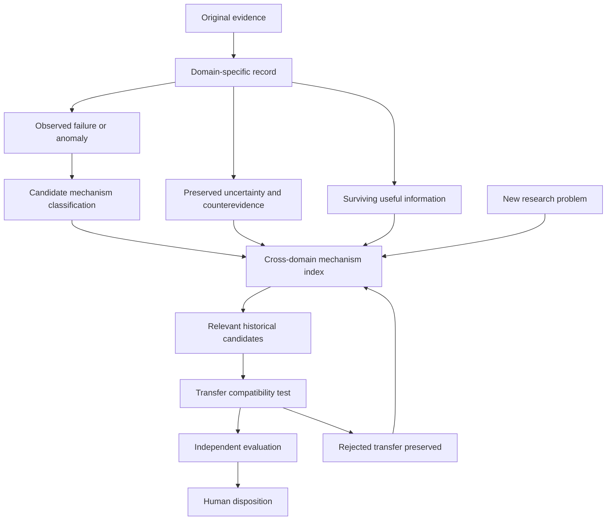

# EC-MIKA-001 | Encyclopedia of Chaos: Mechanism-Indexed Knowledge Architecture

**Version:** v0.1 | **Date:** 2026-11-24 (America/Chicago) | **State:** YELLOW / REVIEW-ONLY DESIGN CANDIDATE
**Human disposition:** Explicit repository placement approval received in conversation. Placement does not admit the proposed taxonomy as canonical, independently validate the design, authorize implementation, migrate existing records, or approve further publication or deployment.
**Scope:** Existing Encyclopedia of Chaos / Reality Benchmarks; cross-disciplinary research retrieval. No new constitutional lane or frozen-doctrine amendment.

## 1. Purpose and human requirements

Every candidate should preserve its original domain, source, rejected assumption, failure conditions, remaining useful information, uncertainty, counterevidence, potential transfer applications and reopening conditions.

An entry should be retrievable by failure mechanism, not merely by company, incident or discipline. For example, an investigation of autonomous AI recovery should be able to discover a relevant maritime steering failure without searching exclusively through AI literature.

Organize knowledge by its origin; retrieve it by what it reveals. Preserve rejected hypotheses, null results, anomalies, failed approaches, successful interventions, rejected transfers and investigator mistakes. Rejection is not necessarily falsity; survival of a useful observation is not validation of the original claim.

## 2. Mandatory candidate record fields

| Field | Required content |
|---|---|
| Identifier | Persistent record ID and version |
| Original domain | Discipline and operating environment |
| Source | Original evidence, provenance, retrieval date, custody and limitations |
| Original proposition | What was expected or claimed |
| Rejected assumption | Claim challenged or defeated; distinguish those states |
| Failure mechanism | How failure occurred, if established; otherwise candidate mechanism or UNKNOWN |
| Failure conditions | Necessary, sufficient or associated conditions, explicitly distinguished |
| Observed consequence | What happened; distinguish observed, reported, inferred and unknown |
| Remaining useful information | Evidence, method, observation or hypothesis surviving rejection |
| Uncertainty | Unresolved cause, scope, evidence gaps and competing explanations |
| Counterevidence | Evidence against the interpretation, including positive and negative controls |
| Transfer applications | Other domains and questions potentially informed |
| Transfer limitations | Where the analogy stops; missing compatibility premises |
| Reopening conditions | New evidence, correction, counterexample or context warranting reconsideration |
| Independent review | Reviewer, scope, evidence custody, findings and disposition |
| Authority state | Candidate, admitted, disputed or superseded; human decision provenance |

A field may explicitly say UNKNOWN, NOT TESTED, NOT APPLICABLE (with reason), or PENDING. It must not be invented or silently omitted. Source retrieval is not source custody. Machine-authored summaries are not substitutes for original evidence. Preserve prior versions and correction history; do not silently overwrite failure records. Preserve rejected candidate classifications and transfer hypotheses with their reasons.

## 3. Initial mechanism vocabulary (proposed, non-exhaustive)

| ID | Candidate classification |
|---|---|
| FM-001 | Common-mode dependency failure |
| FM-002 | Local-to-global composition failure |
| FM-003 | Authority leakage |
| FM-004 | Revocation propagation failure |
| FM-005 | Measurement incompatibility |
| FM-006 | Evaluator contamination |
| FM-007 | Correlated evaluation error |
| FM-008 | Recovery-induced failure |
| FM-009 | Manual override failure |
| FM-010 | Incomplete mediation |
| FM-011 | Evidence custody failure |
| FM-012 | Premature causal attribution |
| FM-013 | Objective-induced boundary violation |
| FM-014 | Investigator-induced failure |
| FM-015 | Hidden dependency |
| FM-016 | Temporal incompatibility |
| FM-017 | False redundancy |
| FM-018 | Domain-transfer error |

Many-to-many classification: a record may have several mechanisms; each assignment requires a rationale, evidence status, version, and review state. Separate observed mechanisms from hypotheses, analogies and positive controls. Classifications overlap and are not established universal failure laws. Unclassified evidence remains searchable; absence of a tag is not absence of the mechanism. No canonical admission of these identifiers is implied by placement.

## 4. Conceptual retrieval demonstration (not an executed retrieval test)

Question: What could prevent an autonomous AI system from responding effectively to an external stop command?

| Original domain | Prior scan candidate or existing anchor | Proposed retrieval relation |
|---|---|---|
| Maritime engineering | EC-GL-010: unresponsive manual steering; investigation open | FM-009, candidate mechanism |
| Electrical engineering | EC-GL-001: redundant controllers sharing control logic and sensor inputs | FM-001, FM-017, reported case |
| Distributed systems | EC-GL-003: recovery environment affecting production | FM-008, reported case |
| Aviation | EC-GL-009: independent intervention stopped immediate consequence | Positive control associated with FM-009; not a failed override |
| AI evaluation | EC-CMDF-002: correlated model errors | FM-007; relevant to evaluation independence, not direct evidence of stop failure |
| Banking | EC-GL-007: shared banking processing infrastructure | FM-001, candidate shared-dependency example |
| BoundaryTitan | BT-HC-004 consequence-path dominance | FM-004, FM-010; challenge, not an observed bypass |

EC-GL and EC-CMDF labels refer to prior conversational scan candidates, not admitted or individually placed entries. External incident source records and custody were not reconciled in this placement; do not treat these examples as independently verified evidence. Existing internal anchors are linked below. The illustration demonstrates intended retrieval behavior, not measured performance, causal equivalence, or operational control.

## 5. Candidate information flow

Structural resemblance does not entail mechanistic equivalence. Before using a transfer, identify the source and target systems, corresponding mechanisms, necessary conditions, differences, first unsupported arrow, counterexamples and a defeating observation. Retain negative transfer results and alternatives. A retrieved record is a research lead, not a decision or permission.

## 6. Proposed implementation and tests (not authorized or executed)

Machine-readable JSON records alongside human-readable Markdown entries and an inspectable, versioned mechanism index. Proposed retrieval dimensions: mechanism, consequence, operating conditions, rejected assumption, recovery method, uncertainty, counterevidence, original domain, and source. Preserve provenance from index hit back to original record and evidence.

The index should surface relevant contrary evidence and positive controls as well as supporting cases. Preserve failed searches, omissions, false matches, misclassifications, rejected transfers, and investigator-induced errors. Do not promote similarity scores into causal or authority judgments.

Candidate validation plan: independently curate cross-domain query fixtures and expected relevant/irrelevant records; include maritime-to-AI override query, false analogy, unclassified records, conflicting classifications, corrected versions, and counterevidence retrieval. Measure retrieval precision/recall against the bounded corpus, source traceability, correction propagation and preservation of uncertainty. Thresholds and scope require independent design and human approval before testing. Corpus completeness and retrieval performance remain unknown. No executable schema, index, search engine, data migration or tests are included in this specification.

## 7. Existing archive and research crosswalk

- [The Obstruction That Was Not a Boundary](reality-benchmarks/2026-11-16-ec-ada-jay-or-001-v0.1.md): preserves obstruction, initiative failure and recovery limitations.
- [The Machine as the Source of Transfer Failure](reality-benchmarks/2026-11-17-ec-rfr-001-tf01-v0.1.md): preserves investigator error, transfer discrepancy, correction and unresolved issues.
- [Collateralized Compute Cascade failures and contradictions](reality-benchmarks/2026-11-16-collateralized-compute-cascade-failures-contradictions-v0.1.md): existing failure preservation practice.
- [BT-CMDF-001 cross-model dependency ledger](../research/candidates/2026-11-24-cross-model-dependency-ledger-v0.1.md), blob 50710cf430d7d3ce99f73a94d396aa7d34e50eb9: independence, correlated error, shared dependencies and source retrieval limitations.
- [BT-HC-004 Consequence-Path Dominance](../challenges/BT-HC-004-CONSEQUENCE-PATH-DOMINANCE.yaml): independent authority and stop-path challenge, not a validated control architecture.

Existing nine archive records are not migrated, retagged, rewritten or admitted by this placement. Prior candidate scan remains separate.

## 8. Disposition and authority

Design candidate specified; mandatory record structure prepared; 18 proposed mechanism classifications; conceptual retrieval example prepared; machine-readable schema NOT IMPLEMENTED; retrieval engine NOT IMPLEMENTED; independent validation NOT PERFORMED. YELLOW.

Named review/admission and external stop owner: BoundaryTitan human repository owner. Machine role: evidence preparation, candidate classification, retrieval and transfer proposals; no certification, risk acceptance, canonical admission or consequential execution authority. Reopen on human direction, demonstrable misclassification, omitted relevant evidence, false transfer, provenance loss, or independent review findings. Frozen doctrine unchanged.

Placement decision: identifier EC-MIKA-001 and archive-root path selected for this design specification, rather than placing it among individual incident records. No new lane. Repository placement only.

**Sigma-2 candidate summary:** Organize knowledge by where it originated. Retrieve knowledge by what it reveals. Preserve knowledge even when its original purpose fails.

Freeze the evidence. Never freeze the search.
CAN ⊬ MAY. ⚒️
